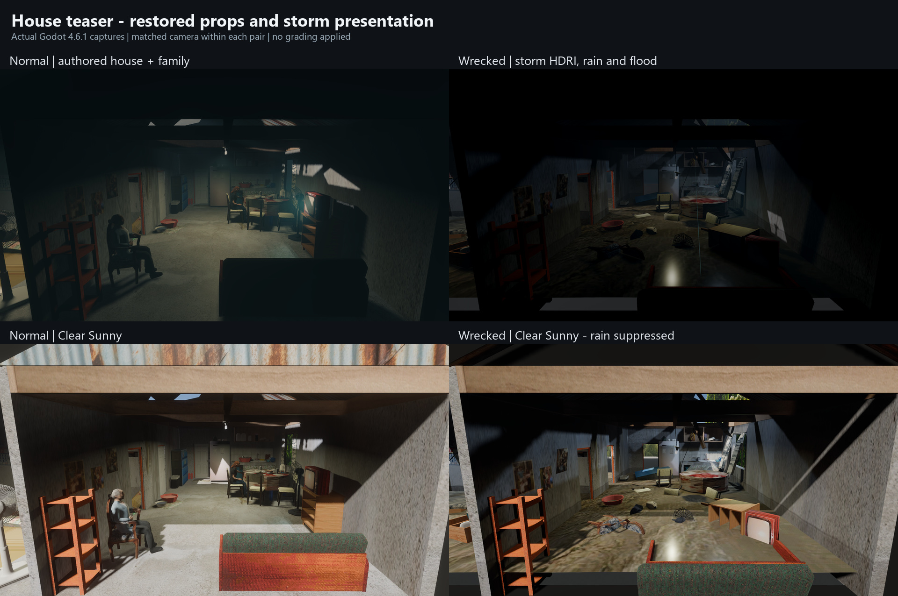
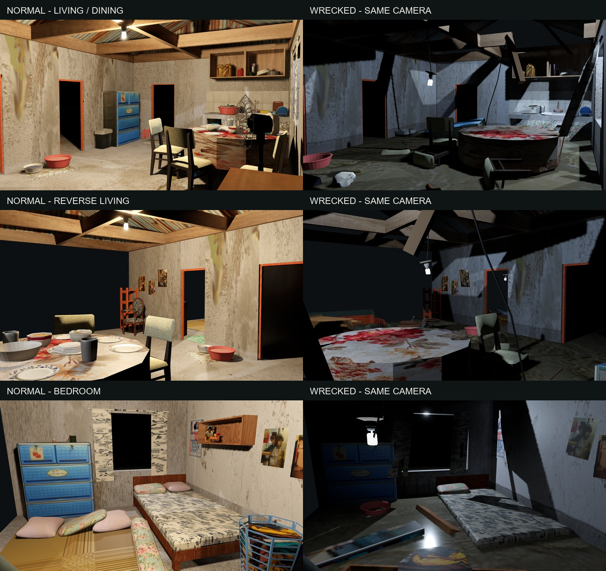

# House teaser: Godot verification

The latest props/weather follow-up restores the full gameplay house for Normal: doors, TV, sofa, chairs, Nanay, Lola and surrounding trees at their authored scale/placement. Hide NPCs removes both family visuals. Wrecked retains the approved empty-house damage/flood composition, omitted doors, damaged sofa and additional native props. Its TV follows the displaced cabinet.

The top pair uses each state's authored Default Stormy lighting; the lower pair uses Clear Sunny to inspect the furnishings. Camera framing is identical within each pair. Wrecked's Default Stormy includes the existing storm HDRI, fog and rain; Sunrise/Sunny/Sunset replace the sky and suppress rain consistently with ordinary recording locations. The comparison sheets only resize/label actual Godot captures, with no grading.

- [Matched room comparisons](godot_house_rooms_v2.jpg): living/dining, reverse living and bedroom.
- [Hide NPCs comparison](godot_house_npcs_v2.jpg): the same Normal shot with Nanay/Lola shown and hidden.
- [All environment presets](godot_house_presets_v2.jpg): both states under Stormy, Sunrise, Sunny and Sunset.
- [Full-resolution capture folder](adjustments_v2/): 32 PNGs at 1920×1080, including wider prop views and EN/TL panels.

Final follow-up verification: **11,516 headless house checks**, **11,530 rendered checks**, **979 existing camera checks**, and **11,516 packaged internal-debug checks**, all with zero failures. Independent source review found no actionable issue. Full logs are at `C:/Temp/bagyong-house-teaser-adjustments-20261013`; exact coverage and known shutdown/test-UID diagnostics are in [TESTING.md](../../docs/TESTING.md). Manual recording feel and sustained performance remain open. Restart the running game to load the revised scripts.

## Initial integration evidence

The approved Blender house is integrated as a recording-only preset location. These are actual Godot 4.6.1 Forward Plus captures, with the ordinary gameplay scene suppressed by the production camera controller.

Six full PNGs show living/dining, reverse living and bedroom at **1920×1080**. Each normal/wrecked pair uses the same imported review camera transform, aspect and FOV. State-specific practical lighting creates the warm/cool contrast. English and Tagalog recording-panel captures show the location/state choices at 175% UI scale.

Use Pause → Dev Mode → Recording Camera → House teaser. Choose the initial state and enter; **G** changes Normal/Wrecked without moving the camera. Escape restores gameplay. Restart the running game after applying the new scripts/assets.

Verification: 5,611 headless house checks, 5,613 Forward Plus checks, and the existing 979 camera checks passed. The internal debug package ran outside the source project and passed the same 5,611 house checks, including lazy model/texture loading and actual restart/title/teleport/storm cleanup. The public release package passed 3 access-denial checks. Independent source review found no actionable issue.

GLB checks confirm 68 valid embedded images in Normal and 71 in Wrecked, retained wet color factors, textured water and transparent wall marks. The active CSV changes only the recording instructions and adds six labels. Both Blender source hashes remain unchanged.

Detailed logs and the asset-integrity report are under `C:/Temp/bagyong-house-teaser-20261012`. Headless shutdown retains the existing ObjectDB/resource-in-use diagnostics separately from passing assertions. Floating objects are static poses. Physical recording controls, sustained capture performance and a complete natural gameplay run remain unverified. The test-entry packages were removed after verification to reclaim disk space; they were not distribution builds.
